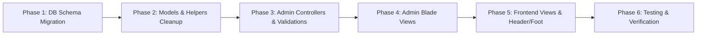

# Complete Plan: Total Removal of Multi-Language Architecture (English-Only Conversion)

## 1. Executive Summary

Liquor Junction was originally structured to support bilingual operation (English and French), featuring duplicate database columns with the `_fr` suffix across 13+ database tables, dedicated `languages` table, frontend/admin language switchers, French validation rules across controllers, and conditional session checks (`\Session::get('language') == 1 ? $title : $title_fr`) in Blade templates.

The project requirement is to **completely deprecate and remove all multi-language processes, French fields, and language-switching mechanisms**, converting the application into a pure, clean, single-language English system.

```mermaid
flowchart TD
    subgraph Current Architecture [Current Multi-Language Architecture]
        DB_FR[DB: 13+ Tables with _fr columns & languages table]
        CTRL_FR[Controllers: Validates & saves both EN & FR fields]
        ADMIN_FR[Admin UI: Duplicate inputs Title EN / Title FR]
        FE_FR[Frontend: Session-based switcher EN/FR & ternary checks]
    end

    subgraph Target Architecture [Target English-Only Architecture]
        DB_EN[DB: Pure English columns, dropped _fr & languages tables]
        CTRL_EN[Controllers: Clean single-field validation & storage]
        ADMIN_EN[Admin UI: Single clean input per field]
        FE_EN[Frontend: Direct English rendering without session overhead]
    end

    Current Architecture ==>|Migration & Refactor| Target Architecture
```

---

## 2. Database Schema Refactoring

### 2.1. Tables & Columns to be Removed
A dedicated Laravel migration will drop all `_fr` columns and deprecated language tables:

| # | Table Name | Columns to Drop / Action | Reason |
|---|---|---|---|
| 1 | `products` | `product_name_fr`, `short_description_fr`, `page_content_fr` | Obsolete French product data |
| 2 | `categories` | `title_fr`, `description_fr` | Obsolete French category data |
| 3 | `sub_categories` | `title_fr`, `description_fr` | Obsolete French subcategory data |
| 4 | `brands` | `title_fr` | Obsolete French brand data |
| 5 | `area` | `title_fr` | Obsolete French area data |
| 6 | `region` | `title_fr` | Obsolete French region data |
| 7 | `banners` | `title_fr`, `description_fr` | Obsolete French banner data |
| 8 | `blogs` | `title_fr` | Obsolete French blog title |
| 9 | `cms` | `page_content_fr`, `mobile_page_content_fr` | Obsolete French CMS page content |
| 10 | `faqs` | `question_name_fr`, `answer_fr` | Obsolete French FAQ questions & answers |
| 11 | `inquiry_reasons` | `title_fr` | Obsolete French inquiry reasons |
| 12 | `labels` | `label_value_fr` | Obsolete French translation values |
| 13 | `store_details` | `store_name_fr` | Obsolete French store names |
| 14 | `webmaster_settings` / `settings` | `address_fr`, `language_id` | Obsolete French company address & default language |
| 15 | `languages` | **Drop Table entirely** (`Schema::dropIfExists('languages')`) | Language management no longer required |

### 2.2. Migration Implementation
A reversible migration `xxxx_xx_xx_remove_multilanguage_and_fr_columns.php` will be created:
- **`up()`**: Safely checks `Schema::hasColumn(...)` and drops each `_fr` column using `$table->dropColumn(...)`, then drops the `languages` table.
- **`down()`**: Re-adds columns as nullable if rollback is ever required.

---

## 3. Backend & Eloquent Models

### 3.1. Models to Update (`app/Models/`)
Remove `_fr` attributes from `$fillable` arrays and delete obsolete language relationships:

1. `Product.php`: Remove `product_name_fr`, `short_description_fr`, `page_content_fr`.
2. `Categories.php`: Remove `title_fr`, `description_fr`.
3. `SubCategories.php`: Remove `title_fr`, `description_fr`.
4. `Brand.php`: Remove `title_fr`.
5. `Area.php`: Remove `title_fr`.
6. `Region.php`: Remove `title_fr`.
7. `Banner.php`: Remove `title_fr`, `description_fr`, and remove `hasOne(Language)`.
8. `Cms.php`: Remove `page_content_fr`, `mobile_page_content_fr`, and remove `hasOne(Language)`.
9. `Faq.php`: Remove `question_name_fr`, `answer_fr`, and remove `hasOne(Language)`.
10. `InquiryReason.php`: Remove `title_fr`.
11. `Label.php`: Remove `label_value_fr`, and remove `hasOne(Language)`.
12. `StoreDetails.php`: Remove `store_name_fr`.
13. `Setting.php`: Remove `hasOne(Language)`.
14. `Language.php`: Deprecate / remove model file.

### 3.2. Helpers & Config Cleanup
- **`app/Helpers/Helper.php`**:
  - Simplify `Helper::language($keys)`:
    ```php
    // Before: Checked Session::get('language') == 2 and returned label_value_fr
    // After: Pure single lookup returning label_value
    static function language($keys) {
        $get_result = Label::where(['status' => 1, 'label_name' => $keys, 'label_type' => 1])->first();
        return !empty($get_result) ? $get_result->label_value : "";
    }
    ```
  - Remove all deprecated language listing helpers (`Helper::languagesList()`, etc.).
- **`config/app.php`**:
  - Remove `'available_locales' => ['fr']`.
  - Ensure `'locale' => 'en'` and `'fallback_locale' => 'en'` are static.

---

## 4. Admin Dashboard Refactoring

### 4.1. Controllers & Request Validations
The following controllers will be updated to remove `_fr` validation rules (`required`, `max`, unique checks), remove `_fr` property assignments on model save/update, and remove `_fr` columns from DataTables AJAX responses:

| Controller | Validation Rules to Remove | Data Save/Update to Remove |
|---|---|---|
| `AreaController.php` | `'title_fr' => 'required'` | `$area->title_fr = ...` |
| `BannerController.php` | `'title_fr' => 'required'`, `'description_fr' => 'required'` | `$Banner->title_fr = ...`, `$Banner->description_fr = ...` |
| `BlogController.php` | `'title_fr' => 'required\|max:40'` | `$blog->title_fr = ...` |
| `BrandController.php` | `'title_fr' => 'required'` | `$brand->title_fr = ...` |
| `CategoriesController.php` | `'title_fr' => 'required'`, `'description_fr' => ...` | `$category->title_fr = ...`, `$category->description_fr = ...` |
| `SubCategoriesController.php` | `'title_fr' => 'required'` | `$subcategory->title_fr = ...` |
| `CmsController.php` | `'page_content_fr' => ...` | `$cms->page_content_fr = ...` |
| `FaqController.php` | `'question_name_fr' => 'required'`, `'answer_fr' => ...` | `$faq->question_name_fr = ...`, `$faq->answer_fr = ...` |
| `InquiryReasonController.php` | `'title_fr' => 'required'` | `$reason->title_fr = ...` |
| `LabelController.php` | `'label_value_fr' => 'required'` | `$label->label_value_fr = ...` |
| `ProductController.php` (Admin) | `'product_name_fr' => ...` | `$product->product_name_fr = ...` |
| `RegionController.php` | `'title_fr' => 'required'` | `$region->title_fr = ...` |
| `StoreController.php` | `'store_name_fr' => 'required\|max:60'` | `$store->store_name_fr = ...` |
| `WebmasterSettingsController.php` | `languages_store`, `address_fr` | Obsolete language routing and settings |

### 4.2. Admin Blade Views (Forms & UI)
Remove all duplicate French input fields, tabs, and validation messages across:
- **`resources/views/dashboard/area/`**: `create.blade.php`, `edit.blade.php`, `show.blade.php` (remove `title_fr`).
- **`resources/views/dashboard/banner/`**: `create.blade.php`, `edit.blade.php`, `show.blade.php` (remove `title_fr`, `description_fr`).
- **`resources/views/dashboard/blog/`**: `create.blade.php`, `edit.blade.php`, `show.blade.php` (remove `title_fr`).
- **`resources/views/dashboard/brand/`**: `create.blade.php`, `edit.blade.php`, `show.blade.php` (remove `title_fr`).
- **`resources/views/dashboard/category/`**: `create.blade.php`, `edit.blade.php`, `show.blade.php` (remove `title_fr`, `description_fr`).
- **`resources/views/dashboard/subcategory/`**: `create.blade.php`, `edit.blade.php`, `show.blade.php` (remove `title_fr`, `description_fr`).
- **`resources/views/dashboard/cms/`**: `create.blade.php`, `edit.blade.php`, `show.blade.php` (remove `page_content_fr`, `mobile_page_content_fr`).
- **`resources/views/dashboard/faq/`**: `create.blade.php`, `edit.blade.php`, `show.blade.php` (remove `question_name_fr`, `answer_fr`).
- **`resources/views/dashboard/inquiry_reason/`**: `create.blade.php`, `edit.blade.php`, `show.blade.php` (remove `title_fr`).
- **`resources/views/dashboard/label/`**: `create.blade.php`, `edit.blade.php`, `show.blade.php` (remove `label_value_fr`).
- **`resources/views/dashboard/product/`**: `create.blade.php`, `edit.blade.php`, `show.blade.php` (remove `product_name_fr`, `short_description_fr`, `page_content_fr`).
- **`resources/views/dashboard/region/`**: `create.blade.php`, `edit.blade.php`, `show.blade.php` (remove `title_fr`).
- **`resources/views/dashboard/layouts/settings.blade.php`**: Remove language switcher menu and flag icons.
- **Client-side Script Cleanup**: Remove all `title_fr: "required"` rules inside form `<script>` blocks.

---

## 5. Frontend Website Refactoring

### 5.1. Header & Navigation (`header.blade.php`)
- Remove `<li class="site_language">...<select id="langchange">...</select></li>`.
- Clean Category & Subcategory loops:
  ```blade
  {{-- Before --}}
  @php
      if (\Session::get('language') == 1) {
          $category_title = $result->title;
      } else {
          $category_title = $result->title_fr ? $result->title_fr : $result->title;
      }
  @endphp

  {{-- After --}}
  <a href="{{ route('productlist', ['id' => Helper::encodeUrl($result->id)]) }}">
      {{ $result->title }}
  </a>
  ```

### 5.2. Footer, Head & Layouts
- **`foot.blade.php`**: Remove the `$("#langchange").on('change', ...)` AJAX listener.
- **`head.blade.php`**: Remove `<body class="@if(\Session::get('language')!=1){{'fr-FR'}}@endif">` — replace with clean `<body id="appBody">`.

### 5.3. Routes & Frontend Controllers
- **`routes/web.php`**: Remove `Route::post('/change-language', [HomeController::class, 'changeLanguage'])->name('frontend.changeLanguage');`.
- **`HomeController.php`**: Remove the `changeLanguage` method.

### 5.4. Frontend Blade Templates
Streamline all content display to direct English properties across:
- **CMS pages** (`about_us`, `contact_us`, `delivery_and_returns`, `our_shops`, `shopping_with_us`, `help_and_support`): Drop `\Session::get('language') == 1 ? page_content : page_content_fr`.
- **Product Listing & Details**: Display `$product->product_name`, `$product->short_description`, `$product->page_content`.
- **Search Autocomplete & Results**: Remove language condition in search query controllers and views (`searching.blade.php`).
- **Special Offers & Banners**: Render `$banner->title` and `$banner->description` directly.

---

## 6. Execution Phases & Safety Checklist



### Safety & Integrity Checklist:
1. **Zero Data Loss on English Content**: All primary English columns (`title`, `product_name`, `description`, `label_value`, `page_content`) remain 100% untouched and preserved.
2. **No Broken Admin Form Submissions**: Removing validation rules in sync with Blade input removals guarantees forms submit cleanly with zero missing-field errors.
3. **Performance Boost**:
   - Reduces database table row sizes by dropping unused French text/blob columns.
   - Eliminates session overhead, language queries, and runtime ternary conditionals on every page load.
4. **Local-Only Git Verification**: Changes will be staged and committed cleanly in local git without any remote pushes.
