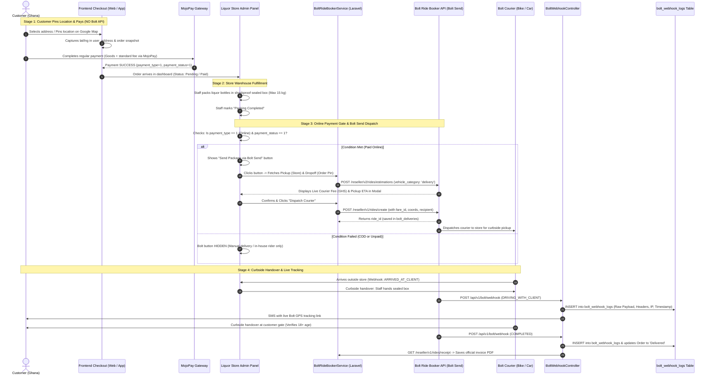

# Bolt Send (Parcel Delivery API) — End-to-End Laravel Implementation Guide for LiquorJunction
## (Updated Architecture: Customer Location Pinning + Admin Online Payment Gate & Dispatch)

---

## 1. Architecture Blueprint & System Overview

This implementation guide details the updated, production-ready integration of the **Bolt Send API (`vehicle_category: "delivery"`)** for **LiquorJunction** in Ghana (Accra, Kumasi, Takoradi).

### Core Business Rules Implemented:
1. **Frontend / Customer Checkout (Zero Bolt Calls)**:
   - When a customer adds/selects a delivery address, they pin their location on Google Maps.
   - The coordinates (`latitude`, `longitude`) are captured and saved in `user_address` and snapshotted into `order.delivery_latitude` and `order.delivery_longitude`.
   - **Bolt API is NOT called at checkout!** No fare estimation, no dynamic quote, no API latency for the buyer.
   - Payment and standard delivery fee calculation proceed through the **existing platform flow** (e.g. MojoPay payment gateway).
2. **Admin-Side Bolt API Integration**:
   - All Bolt Send API calls are handled strictly inside the **Admin Dashboard** (`Dashboard/OrderController`).
   - **Pickup Location**: Pulled dynamically from the store/warehouse coordinates (`store_details.latitude`, `store_details.longitude`, `store_details.address` via `$order->supplier_id`), fully preserving the existing store fulfillment architecture without alterations.
   - **Dropoff Location**: Pulled directly from the order's customer-pinned GPS coordinates (`order.delivery_latitude`, `order.delivery_longitude`, `order.delivery_address`).
3. **Admin Trigger & Condition Gate**:
   - **Condition**: The "Send Package via Bolt Send" button is **ONLY displayed if the order was paid via Online Payment** (`payment_type == 1` and `payment_status == 1`) and is a Home Delivery order (`order_type == 1`).
   - If the order is Cash on Delivery (COD / `payment_type == 3`), Store Pickup (`order_type == 2`), or Unpaid, the Bolt dispatch button is **HIDDEN**.
   - When the fulfillment manager clicks "Send Package via Bolt Send", an interactive modal loads the Pickup (Store) and Dropoff (Customer) locations, fetches a live Bolt Send quotation, and dispatches the courier upon confirmation.
4. **Permanent Webhook Audit Logging (`bolt_webhook_logs`)**:
   - Every single webhook request from Bolt is logged with raw payload, HTTP headers, client IP, and timestamps ("Kab, Kya, Kese Call Hua").

---

### End-to-End Sequence Diagram



---

## 2. Pehle Kya Chahiye (Prerequisites & Requirements)

Before writing or running code, ensure the following keys, configurations, and database tables are in place:

### 2.1 API Credentials & Environment Variables
Add to `.env`:
```env
# ========================================================
# BOLT RIDE BOOKER / BOLT SEND API CONFIGURATION
# ========================================================
BOLT_ENV=sandbox # 'sandbox' or 'production'
BOLT_CLIENT_ID=your_bolt_client_id_here
BOLT_CLIENT_SECRET=your_bolt_client_secret_here
BOLT_SANDBOX_UUID=b1034a93-c5af-4fa1-a3b5-1bdb255f8967
BOLT_WEBHOOK_SECRET=your_custom_secure_bearer_token_for_webhooks
BOLT_DEFAULT_COUNTRY=GH
BOLT_CURRENCY=GHS

# ========================================================
# GOOGLE MAPS API KEY (For Customer Location Pinning)
# ========================================================
GOOGLE_MAPS_API_KEY=your_google_maps_browser_key_here
```

### 2.2 Bolt Configuration File: `config/bolt.php`
Create or update `config/bolt.php`:
```php
<?php

return [
    'env' => env('BOLT_ENV', 'sandbox'),
    'client_id' => env('BOLT_CLIENT_ID'),
    'client_secret' => env('BOLT_CLIENT_SECRET'),
    'sandbox_uuid' => env('BOLT_SANDBOX_UUID'),
    'webhook_secret' => env('BOLT_WEBHOOK_SECRET'),

    'oauth_url' => 'https://oidc.bolt.eu/token',
    
    'base_url' => env('BOLT_ENV') === 'production'
        ? 'https://node.bolt.eu/ride-booker-api/reseller/v1/'
        : 'https://node.bolt.eu/ride-booker-api-sandbox/reseller/v1/sandbox/',

    'estimations_url' => env('BOLT_ENV') === 'production'
        ? 'https://node.bolt.eu/ride-booker-api/reseller/v2/rides/estimations'
        : 'https://node.bolt.eu/ride-booker-api-sandbox/reseller/v2/sandbox/rides/estimations',

    'country' => env('BOLT_DEFAULT_COUNTRY', 'GH'),
    'currency' => env('BOLT_CURRENCY', 'GHS'),
    'google_maps_key' => env('GOOGLE_MAPS_API_KEY'),
];
```

---

## 3. Database Migrations

### 3.1 Migration 1: Add Coordinates to `user_address` & `order`
```bash
php artisan make:migration add_coordinates_to_user_address_and_order_tables
```

```php
<?php

use Illuminate\Database\Migrations\Migration;
use Illuminate\Database\Schema\Blueprint;
use Illuminate\Support\Facades\Schema;

return new class extends Migration
{
    public function up()
    {
        // 1. Customer Saved Shipping Address Book
        Schema::table('user_address', function (Blueprint $table) {
            $table->decimal('latitude', 10, 7)->nullable()->after('address');
            $table->decimal('longitude', 10, 7)->nullable()->after('latitude');
            $table->string('place_id')->nullable()->after('longitude');
            $table->text('formatted_address')->nullable()->after('place_id');
        });

        // 2. Order Shipping Snapshot (Immutable coordinates at moment of purchase)
        Schema::table('order', function (Blueprint $table) {
            $table->decimal('delivery_latitude', 10, 7)->nullable()->after('delivery_address');
            $table->decimal('delivery_longitude', 10, 7)->nullable()->after('delivery_latitude');
        });
    }

    public function down()
    {
        Schema::table('user_address', function (Blueprint $table) {
            $table->dropColumn(['latitude', 'longitude', 'place_id', 'formatted_address']);
        });

        Schema::table('order', function (Blueprint $table) {
            $table->dropColumn(['delivery_latitude', 'delivery_longitude']);
        });
    }
};
```

### 3.2 Migration 2: Create `bolt_deliveries` Table
```bash
php artisan make:migration create_bolt_deliveries_table
```

```php
<?php

use Illuminate\Database\Migrations\Migration;
use Illuminate\Database\Schema\Blueprint;
use Illuminate\Support\Facades\Schema;

return new class extends Migration
{
    public function up()
    {
        Schema::create('bolt_deliveries', function (Blueprint $table) {
            $table->id();
            $table->unsignedBigInteger('order_id')->index();
            $table->string('ride_id')->nullable()->index();
            $table->string('fare_id')->nullable();
            $table->timestamp('fare_locked_at')->nullable();
            $table->string('vehicle_category')->default('delivery'); // 'delivery' = Bolt Send
            $table->string('state')->default('CREATED'); // SEARCHING, DRIVER_ACCEPTED, etc.
            $table->decimal('pickup_lat', 10, 7);
            $table->decimal('pickup_lng', 10, 7);
            $table->string('pickup_address')->nullable();
            $table->decimal('dropoff_lat', 10, 7);
            $table->decimal('dropoff_lng', 10, 7);
            $table->string('dropoff_address')->nullable();
            $table->string('recipient_name');
            $table->string('recipient_phone');
            $table->text('note_to_driver')->nullable();
            $table->string('driver_name')->nullable();
            $table->string('driver_phone')->nullable();
            $table->string('car_model')->nullable();
            $table->string('car_reg_number')->nullable();
            $table->string('driver_picture')->nullable();
            $table->string('tracking_url')->nullable();
            $table->decimal('estimated_amount', 10, 2)->nullable();
            $table->decimal('final_amount', 10, 2)->nullable();
            $table->string('currency', 10)->default('GHS');
            $table->string('invoice_url')->nullable();
            $table->json('raw_response')->nullable();
            $table->timestamps();

            $table->foreign('order_id')->references('id')->on('order')->onDelete('cascade');
        });
    }

    public function down()
    {
        Schema::dropIfExists('bolt_deliveries');
    }
};
```

### 3.3 Migration 3: Create `bolt_webhook_logs` Table (Audit Logging)
```bash
php artisan make:migration create_bolt_webhook_logs_table
```

```php
<?php

use Illuminate\Database\Migrations\Migration;
use Illuminate\Database\Schema\Blueprint;
use Illuminate\Support\Facades\Schema;

return new class extends Migration
{
    public function up()
    {
        Schema::create('bolt_webhook_logs', function (Blueprint $table) {
            $table->id();
            $table->string('event_type')->index(); // 'ride.status_changed'
            $table->string('ride_id')->nullable()->index();
            $table->string('state')->nullable()->index(); // 'COMPLETED', etc.
            $table->string('ip_address')->nullable();
            $table->json('headers')->nullable();
            $table->json('payload'); // Raw incoming payload
            $table->integer('http_status')->default(200);
            $table->text('error_message')->nullable();
            $table->timestamps();
        });
    }

    public function down()
    {
        Schema::dropIfExists('bolt_webhook_logs');
    }
};
```

---

## 4. Frontend Customer Location Pinning (Zero Bolt API Overhead)

During checkout or when a customer adds/edits a shipping address, they drop a pin on Google Maps. Only coordinates are captured.

### 4.1 Address Modal Map Pin Blade (`resources/views/frontend/address/address_modal.blade.php`)
```html
<!-- Google Maps Address Pinning Component -->
<div class="form-group mb-3">
    <label class="form-label font-weight-bold">
        <i class="fa fa-map-marker-alt text-danger"></i> Pin Your Delivery Location on Map
    </label>
    <p class="text-muted small mb-2">Search your street or drag the marker to your gate for accurate courier delivery.</p>
    
    <input id="map-search-box" type="text" class="form-control mb-2" placeholder="Search landmark, street, or digital address in Accra/Kumasi...">
    
    <div id="customer-picker-map" style="height: 280px; width: 100%; border-radius: 8px; border: 1px solid #ddd;"></div>
</div>

<!-- Hidden inputs saved with address form -->
<input type="hidden" name="latitude" id="address-latitude" value="{{ old('latitude', @$userAddress->latitude) }}">
<input type="hidden" name="longitude" id="address-longitude" value="{{ old('longitude', @$userAddress->longitude) }}">
<input type="hidden" name="place_id" id="address-place-id" value="{{ old('place_id', @$userAddress->place_id) }}">
<input type="hidden" name="formatted_address" id="address-formatted" value="{{ old('formatted_address', @$userAddress->formatted_address) }}">
```

### 4.2 Google Maps JavaScript Pinning Logic
```javascript
let map, marker, autocomplete;
const DEFAULT_LAT = 5.6037; // Accra default latitude
const DEFAULT_LNG = -0.1870; // Accra default longitude

function initCustomerAddressMap() {
    const existingLat = parseFloat(document.getElementById('address-latitude').value) || DEFAULT_LAT;
    const existingLng = parseFloat(document.getElementById('address-longitude').value) || DEFAULT_LNG;
    const initialPosition = { lat: existingLat, lng: existingLng };

    map = new google.maps.Map(document.getElementById('customer-picker-map'), {
        center: initialPosition,
        zoom: 15,
        mapTypeControl: false,
        streetViewControl: false,
    });

    marker = new google.maps.Marker({
        position: initialPosition,
        map: map,
        draggable: true,
        animation: google.maps.Animation.DROP,
        title: "Drag to your gate"
    });

    const searchInput = document.getElementById('map-search-box');
    autocomplete = new google.maps.places.Autocomplete(searchInput, {
        componentRestrictions: { country: "gh" }, // Strictly restricted to Ghana
        fields: ["geometry", "formatted_address", "place_id"]
    });

    autocomplete.addListener('place_changed', function() {
        const place = autocomplete.getPlace();
        if (!place.geometry || !place.geometry.location) return;

        map.setCenter(place.geometry.location);
        map.setZoom(17);
        marker.setPosition(place.geometry.location);
        updateHiddenCoordinates(place.geometry.location.lat(), place.geometry.location.lng(), place.place_id, place.formatted_address);
    });

    google.maps.event.addListener(marker, 'dragend', function(event) {
        updateHiddenCoordinates(event.latLng.lat(), event.latLng.lng());
    });
}

function updateHiddenCoordinates(lat, lng, placeId = '', formatted = '') {
    document.getElementById('address-latitude').value = lat;
    document.getElementById('address-longitude').value = lng;
    if (placeId) document.getElementById('address-place-id').value = placeId;
    if (formatted) document.getElementById('address-formatted').value = formatted;
}
```

### 4.3 Order Placement Snapshot in `CheckoutController.php`
When the order is created in `storePlaceOrder()`, the pinned coordinates are copied directly to the order record without calling Bolt:

```php
// In CheckoutController@storePlaceOrder:
$order->delivery_address = $delivery_address;
$order->delivery_address_id = $user_address_id;

// Snapshot pinned coordinates from user_address
if ($user_address_data) {
    $order->delivery_latitude = $user_address_data->latitude;
    $order->delivery_longitude = $user_address_data->longitude;
}

$order->save();

// Customer proceeds to normal payment (MojoPay online or COD)
```

---

## 5. Bolt Send Service Implementation

File: `app/Services/BoltRideBookerService.php`

```php
<?php

namespace App\Services;

use Illuminate\Support\Facades\Http;
use Illuminate\Support\Facades\Cache;
use Illuminate\Support\Facades\Log;
use Carbon\Carbon;
use Exception;

class BoltRideBookerService
{
    protected string $baseUrl;
    protected string $estimationsUrl;
    protected string $clientId;
    protected string $clientSecret;
    protected ?string $sandboxUuid;

    public function __construct()
    {
        $this->baseUrl = config('bolt.base_url');
        $this->estimationsUrl = config('bolt.estimations_url');
        $this->clientId = config('bolt.client_id');
        $this->clientSecret = config('bolt.client_secret');
        $this->sandboxUuid = config('bolt.sandbox_uuid');
    }

    /**
     * Retrieve OAuth2 Access Token (Cached for 50 minutes)
     */
    public function getAccessToken(): string
    {
        return Cache::remember('bolt_access_token', 3000, function () {
            $response = Http::asForm()->post(config('bolt.oauth_url'), [
                'grant_type' => 'client_credentials',
                'client_id' => $this->clientId,
                'client_secret' => $this->clientSecret,
                'scope' => 'ridebooker:reseller',
            ]);

            if ($response->failed()) {
                Log::error('Bolt OAuth2 Failure: ' . $response->body());
                throw new Exception('Bolt OAuth authentication failed: ' . $response->status());
            }

            return $response->json()['access_token'];
        });
    }

    /**
     * Fetch Live Estimation for Bolt Send (vehicle_category: 'delivery')
     */
    public function getBoltSendEstimate(array $pickup, array $dropoff): array
    {
        $token = $this->getAccessToken();

        $headers = [
            'Authorization' => 'Bearer ' . $token,
            'Content-Type' => 'application/json',
        ];

        if (config('bolt.env') !== 'production' && $this->sandboxUuid) {
            $headers['X-Sandbox-UUID'] = $this->sandboxUuid;
        }

        $payload = [
            'pickup' => [
                'lat' => (float)$pickup['lat'],
                'lng' => (float)$pickup['lng'],
                'address' => $pickup['address'] ?? 'LiquorJunction Store, Accra',
            ],
            'dropoff' => [
                'lat' => (float)$dropoff['lat'],
                'lng' => (float)$dropoff['lng'],
                'address' => $dropoff['address'] ?? 'Customer Destination',
            ],
        ];

        $response = Http::withHeaders($headers)->post($this->estimationsUrl, $payload);

        if ($response->failed()) {
            Log::error('Bolt Estimation Error: ' . $response->body());
            throw new Exception('Failed to get Bolt Send estimation: ' . $response->body());
        }

        $data = $response->json();
        $categories = $data['categories'] ?? [];

        // Match category 'delivery' (Bolt Send) or fallback to 'motorbike'
        $deliveryCategory = null;
        foreach ($categories as $cat) {
            $catName = strtolower($cat['vehicle_category'] ?? '');
            if ($catName === 'delivery' || $catName === 'motorbike') {
                $deliveryCategory = $cat;
                break;
            }
        }

        if (!$deliveryCategory) {
            // Default to first category if 'delivery' is unnamed in sandbox
            $deliveryCategory = $categories[0] ?? null;
        }

        if (!$deliveryCategory) {
            throw new Exception('No available Bolt Send couriers in this area.');
        }

        return [
            'fare_id' => $deliveryCategory['fare_id'],
            'price_amount' => $deliveryCategory['price']['amount'] ?? 0,
            'currency' => $deliveryCategory['price']['currency'] ?? 'GHS',
            'eta_seconds' => $deliveryCategory['eta'] ?? 300,
            'vehicle_category' => $deliveryCategory['vehicle_category'] ?? 'delivery',
            'quoted_at' => Carbon::now()->toIso8601String(),
        ];
    }

    /**
     * Create / Dispatch Bolt Send Ride
     */
    public function createBoltSendRide(
        string $fareId,
        array $pickup,
        array $dropoff,
        string $recipientName,
        string $recipientPhone,
        string $orderNumber,
        ?string $quotedAt = null
    ): array {
        // Auto-refresh fare_id if older than 2 minutes to prevent EXPIRED_FARE_ID
        if ($quotedAt && Carbon::parse($quotedAt)->diffInMinutes(Carbon::now()) >= 2) {
            Log::info("Fare ID expired (> 2 mins). Fetching fresh quote for Order #{$orderNumber}...");
            $freshQuote = $this->getBoltSendEstimate($pickup, $dropoff);
            $fareId = $freshQuote['fare_id'];
        }

        $token = $this->getAccessToken();
        $url = rtrim($this->baseUrl, '/') . '/rides/create';

        $headers = [
            'Authorization' => 'Bearer ' . $token,
            'Content-Type' => 'application/json',
        ];

        if (config('bolt.env') !== 'production' && $this->sandboxUuid) {
            $headers['X-Sandbox-UUID'] = $this->sandboxUuid;
        }

        $formattedPhone = $this->sanitizeGhanaPhone($recipientPhone);

        $payload = [
            'fare_id' => $fareId,
            'pickup' => [
                'lat' => (float)$pickup['lat'],
                'lng' => (float)$pickup['lng'],
                'address' => $pickup['address'] ?? 'Store Pickup',
            ],
            'dropoff' => [
                'lat' => (float)$dropoff['lat'],
                'lng' => (float)$dropoff['lng'],
                'address' => $dropoff['address'] ?? 'Customer Dropoff',
            ],
            'passenger' => [
                'first_name' => $recipientName,
                'last_name' => '(Parcel Recipient)',
                'phone' => $formattedPhone,
            ],
            'payment_method' => 'business',
            'order_reference' => 'LJ-' . $orderNumber,
            'comment' => "FRAGILE LIQUOR PARCEL. Order #{$orderNumber}. Meet store staff at vehicle for curbside pickup.",
        ];

        $response = Http::withHeaders($headers)->post($url, $payload);

        if ($response->failed()) {
            Log::error('Bolt Ride Creation Error: ' . $response->body());
            throw new Exception('Bolt courier dispatch failed: ' . $response->body());
        }

        return $response->json();
    }

    /**
     * Format phone to E.164 standard (+233XXXXXXXXX)
     */
    protected function sanitizeGhanaPhone(string $phone): string
    {
        $cleaned = preg_replace('/[^0-9]/', '', $phone);
        if (str_starts_with($cleaned, '233')) return '+' . $cleaned;
        if (str_starts_with($cleaned, '0')) return '+233' . substr($cleaned, 1);
        return '+233' . $cleaned;
    }

    /**
     * Fetch Live Driver Details & Tracking URL
     */
    public function getRideDetails(int $rideId): array
    {
        $token = $this->getAccessToken();
        $url = rtrim($this->baseUrl, '/') . "/rides/{$rideId}/details";

        $headers = ['Authorization' => 'Bearer ' . $token];
        if (config('bolt.env') !== 'production' && $this->sandboxUuid) {
            $headers['X-Sandbox-UUID'] = $this->sandboxUuid;
        }

        $response = Http::withHeaders($headers)->get($url);
        return $response->json();
    }

    /**
     * Fetch Official Ride Receipt & Final Fare Invoice
     */
    public function getRideReceipt(int $rideId): array
    {
        $token = $this->getAccessToken();
        $url = rtrim($this->baseUrl, '/') . "/rides/{$rideId}/receipt";

        $headers = ['Authorization' => 'Bearer ' . $token];
        if (config('bolt.env') !== 'production' && $this->sandboxUuid) {
            $headers['X-Sandbox-UUID'] = $this->sandboxUuid;
        }

        $response = Http::withHeaders($headers)->get($url);
        return $response->json();
    }
}
```

---

## 6. Admin Panel: Online Payment Gate & Dispatch Modal

### 6.1 Condition Check in Admin Order View (`resources/views/dashboard/order/show.blade.php`)

Add the following block to the Action Bar on the Admin Order Details page:

```blade
{{-- BOLT SEND DISPATCH GATE: ONLY SHOW FOR ONLINE PAID HOME DELIVERY ORDERS --}}
@php
    $isHomeDelivery = ($orderData->order_type == 1);
    $isOnlinePaid = ($orderData->payment_type == 1 && $orderData->payment_status == 1);
    $existingDelivery = \DB::table('bolt_deliveries')->where('order_id', $orderData->id)->latest()->first();
@endphp

@if($isHomeDelivery && $isOnlinePaid)
    <div class="card border-primary shadow-sm mb-4">
        <div class="card-header bg-primary text-white d-flex justify-content-between align-items-center">
            <h5 class="mb-0"><i class="fa fa-motorcycle"></i> Bolt Send Courier Fulfillment</h5>
            <span class="badge badge-light text-primary font-weight-bold">Online Payment Verified</span>
        </div>
        <div class="card-body">
            @if(!$existingDelivery)
                <p class="text-muted">
                    This order was paid online. The customer's pinned coordinates are ready. 
                    Verify bottles are packed and sealed before dispatching a courier.
                </p>
                <div class="d-flex align-items-center gap-2">
                    <button type="button" class="btn btn-success" id="btn-open-bolt-modal" data-order-id="{{ $orderData->id }}">
                        <i class="fa fa-paper-plane"></i> Send Package via Bolt Send
                    </button>
                </div>
            @else
                <div class="alert alert-info d-flex justify-content-between align-items-center mb-0">
                    <div>
                        <strong>Bolt Ride #{{ $existingDelivery->ride_id }}</strong> | 
                        Status: <span class="badge badge-warning text-uppercase">{{ $existingDelivery->state }}</span>
                        @if($existingDelivery->driver_name)
                            <div class="small mt-1">Driver: {{ $existingDelivery->driver_name }} ({{ $existingDelivery->car_reg_number }}) - Tel: {{ $existingDelivery->driver_phone }}</div>
                        @endif
                    </div>
                    @if($existingDelivery->tracking_url)
                        <a href="{{ $existingDelivery->tracking_url }}" target="_blank" class="btn btn-sm btn-outline-primary">
                            <i class="fa fa-map-marked-alt"></i> Live GPS Tracking
                        </a>
                    @endif
                </div>
            @endif
        </div>
    </div>
@elseif($orderData->payment_type == 3)
    <div class="alert alert-warning mb-4">
        <i class="fa fa-info-circle"></i> <strong>Cash On Delivery (COD) Order:</strong> 
        Bolt Send requires centralized pre-payment. COD orders must be fulfilled by store in-house delivery staff.
    </div>
@elseif(!$isOnlinePaid)
    <div class="alert alert-secondary mb-4">
        <i class="fa fa-clock"></i> <strong>Payment Pending:</strong> 
        Bolt Send courier dispatch is locked until online payment is confirmed.
    </div>
@endif
```

### 6.2 Admin Bolt Send Configuration Modal (HTML / Blade)
Place at the bottom of `resources/views/dashboard/order/show.blade.php`:

```html
<!-- Bolt Send Configuration & Dispatch Modal -->
<div class="modal fade" id="boltDispatchModal" tabindex="-1" role="dialog" aria-hidden="true">
    <div class="modal-dialog modal-lg" role="document">
        <div class="modal-content">
            <div class="modal-header bg-dark text-white">
                <h5 class="modal-title"><i class="fa fa-shipping-fast text-warning"></i> Configure & Dispatch Bolt Send Parcel</h5>
                <button type="button" class="close text-white" data-dismiss="modal">&times;</button>
            </div>
            <div class="modal-body">
                <div id="bolt-loading" class="text-center py-4">
                    <div class="spinner-border text-primary" role="status"></div>
                    <p class="mt-2 text-muted">Calculating route & live quotation from Bolt Send API...</p>
                </div>

                <div id="bolt-content" style="display: none;">
                    <div class="row">
                        <!-- Pickup Column -->
                        <div class="col-md-6 border-right">
                            <h6 class="text-success font-weight-bold"><i class="fa fa-store"></i> Store Pickup Location</h6>
                            <p class="mb-1" id="pickup-store-name"><strong>LiquorJunction Store</strong></p>
                            <p class="small text-muted mb-1" id="pickup-store-address"></p>
                            <span class="badge badge-light" id="pickup-store-coords"></span>
                        </div>

                        <!-- Dropoff Column -->
                        <div class="col-md-6">
                            <h6 class="text-primary font-weight-bold"><i class="fa fa-map-pin"></i> Customer Pinned Dropoff</h6>
                            <p class="mb-1" id="dropoff-recipient-name"></p>
                            <p class="small text-muted mb-1" id="dropoff-customer-address"></p>
                            <span class="badge badge-light" id="dropoff-customer-coords"></span>
                        </div>
                    </div>

                    <hr>

                    <!-- Package Specifications -->
                    <div class="bg-light p-3 rounded mb-3">
                        <div class="d-flex justify-content-between">
                            <span><i class="fa fa-box text-warning"></i> <strong>Package:</strong> Sealed Alcohol Box (Max 15 kg)</span>
                            <span><i class="fa fa-shield-alt text-success"></i> Curbside Verification: <strong>18+ Age Required</strong></span>
                        </div>
                    </div>

                    <!-- Live Quote Box -->
                    <div class="card border-success">
                        <div class="card-body d-flex justify-content-between align-items-center">
                            <div>
                                <h6 class="mb-0 text-muted">Estimated Bolt Delivery Fee:</h6>
                                <h3 class="mb-0 text-success font-weight-bold" id="quote-fee-amount">0.00 GHS</h3>
                            </div>
                            <div class="text-right">
                                <span class="badge badge-info p-2" id="quote-eta">ETA: ~5 mins</span>
                            </div>
                        </div>
                    </div>

                    <!-- Hidden Quote State -->
                    <input type="hidden" id="modal-fare-id">
                    <input type="hidden" id="modal-quoted-at">
                </div>
            </div>
            <div class="modal-footer">
                <button type="button" class="btn btn-secondary" data-dismiss="modal">Cancel</button>
                <button type="button" class="btn btn-primary" id="btn-confirm-bolt-dispatch" disabled>
                    <i class="fa fa-check-circle"></i> Confirm & Dispatch Courier
                </button>
            </div>
        </div>
    </div>
</div>
```

### 6.3 Admin AJAX Script (`resources/views/dashboard/order/show.blade.php`)
```javascript
$(document).ready(function() {
    $('#btn-open-bolt-modal').on('click', function() {
        const orderId = $(this).data('order-id');
        $('#boltDispatchModal').modal('show');
        $('#bolt-loading').show();
        $('#bolt-content').hide();
        $('#btn-confirm-bolt-dispatch').prop('disabled', true);

        // Fetch Route Preview & Live Estimation from Backend
        $.ajax({
            url: `/admin/order/${orderId}/bolt-preview`,
            type: 'GET',
            success: function(res) {
                if (res.success) {
                    $('#pickup-store-name').text(res.pickup.store_name);
                    $('#pickup-store-address').text(res.pickup.address);
                    $('#pickup-store-coords').text(`Lat: ${res.pickup.lat}, Lng: ${res.pickup.lng}`);

                    $('#dropoff-recipient-name').text(`${res.dropoff.recipient_name} (${res.dropoff.recipient_phone})`);
                    $('#dropoff-customer-address').text(res.dropoff.address);
                    $('#dropoff-customer-coords').text(`Lat: ${res.dropoff.lat}, Lng: ${res.dropoff.lng}`);

                    $('#quote-fee-amount').text(`${res.estimate.fee} ${res.estimate.currency}`);
                    $('#quote-eta').text(`Estimated Driver Arrival: ~${res.estimate.eta_mins} mins`);

                    $('#modal-fare-id').val(res.estimate.fare_id);
                    $('#modal-quoted-at').val(res.estimate.quoted_at);

                    $('#bolt-loading').hide();
                    $('#bolt-content').show();
                    $('#btn-confirm-bolt-dispatch').prop('disabled', false).data('order-id', orderId);
                } else {
                    alert('Error: ' + res.message);
                    $('#boltDispatchModal').modal('hide');
                }
            },
            error: function(err) {
                alert('Failed to connect to Bolt API: ' + (err.responseJSON ? err.responseJSON.message : 'Unknown error'));
                $('#boltDispatchModal').modal('hide');
            }
        });
    });

    $('#btn-confirm-bolt-dispatch').on('click', function() {
        const orderId = $(this).data('order-id');
        const fareId = $('#modal-fare-id').val();
        const quotedAt = $('#modal-quoted-at').val();

        $(this).prop('disabled', true).html('<i class="fa fa-spinner fa-spin"></i> Dispatching Courier...');

        $.ajax({
            url: `/admin/order/${orderId}/dispatch-bolt`,
            type: 'POST',
            data: {
                _token: '{{ csrf_token() }}',
                fare_id: fareId,
                quoted_at: quotedAt
            },
            success: function(res) {
                if (res.success) {
                    alert('Bolt Send Courier successfully booked! Ride ID: ' + res.ride_id);
                    location.reload();
                } else {
                    alert('Dispatch Failed: ' + res.message);
                    $('#btn-confirm-bolt-dispatch').prop('disabled', false).html('<i class="fa fa-check-circle"></i> Confirm & Dispatch Courier');
                }
            },
            error: function(err) {
                alert('Dispatch Error: ' + (err.responseJSON ? err.responseJSON.message : 'Network error'));
                $('#btn-confirm-bolt-dispatch').prop('disabled', false).html('<i class="fa fa-check-circle"></i> Confirm & Dispatch Courier');
            }
        });
    });
});
```

---

## 7. Admin Controller Implementation

File: `app/Http/Controllers/Dashboard/OrderController.php`

```php
<?php

namespace App\Http\Controllers\Dashboard;

use App\Http\Controllers\Controller;
use Illuminate\Http\Request;
use App\Models\Order;
use App\Models\UserAddress;
use App\Models\StoreDetails;
use App\Services\BoltRideBookerService;
use Illuminate\Support\Facades\DB;
use Carbon\Carbon;
use Exception;

class OrderController extends Controller
{
    /**
     * Preview Pickup & Dropoff Route and Fetch Live Bolt Estimate
     */
    public function getBoltSendPreview($orderId, BoltRideBookerService $boltService)
    {
        $order = Order::with('orderInfo')->findOrFail($orderId);

        // Enforce Eligibility Condition
        if ($order->order_type != 1) {
            return response()->json(['success' => false, 'message' => 'Store Pickup orders cannot be dispatched via Bolt Send.'], 400);
        }

        if ($order->payment_type != 1 || $order->payment_status != 1) {
            return response()->json(['success' => false, 'message' => 'Bolt Send is only permitted for verified Online Payments.'], 400);
        }

        // 1. Resolve Store Pickup Location (Preserving existing store logic)
        $store = null;
        if (!empty($order->supplier_id)) {
            $store = StoreDetails::where('id', $order->supplier_id)->orWhere('wholesaler_id', $order->supplier_id)->first();
        }
        if (!$store) {
            $store = StoreDetails::where('status', 1)->first();
        }

        $pickup = [
            'store_name' => $store->store_name ?? 'LiquorJunction Warehouse',
            'lat' => (float)$store->latitude,
            'lng' => (float)$store->longitude,
            'address' => $store->address ?? 'Accra, Ghana',
        ];

        // 2. Resolve Customer Dropoff Location (Using Pinned Coordinates)
        $shippingAddress = UserAddress::find($order->delivery_address_id);
        $orderInfo = $order->orderInfo;

        $dropoffLat = $order->delivery_latitude ?? ($shippingAddress->latitude ?? null);
        $dropoffLng = $order->delivery_longitude ?? ($shippingAddress->longitude ?? null);

        if (!$dropoffLat || !$dropoffLng) {
            return response()->json([
                'success' => false,
                'message' => 'Customer did not pin their GPS location on map. Please contact customer to verify coordinates.'
            ], 400);
        }

        $dropoff = [
            'recipient_name' => $order->recipientName ?: ($shippingAddress->name ?? ($orderInfo->customer_name ?? 'Customer')),
            'recipient_phone' => $shippingAddress->phone ?? ($orderInfo->customer_mobile ?? ''),
            'lat' => (float)$dropoffLat,
            'lng' => (float)$dropoffLng,
            'address' => $order->delivery_address ?: ($shippingAddress->address ?? 'Accra, Ghana'),
        ];

        // 3. Call Bolt API for Live Estimation
        try {
            $estimate = $boltService->getBoltSendEstimate(
                ['lat' => $pickup['lat'], 'lng' => $pickup['lng'], 'address' => $pickup['address']],
                ['lat' => $dropoff['lat'], 'lng' => $dropoff['lng'], 'address' => $dropoff['address']]
            );

            return response()->json([
                'success' => true,
                'pickup' => $pickup,
                'dropoff' => $dropoff,
                'estimate' => [
                    'fare_id' => $estimate['fare_id'],
                    'fee' => number_format($estimate['price_amount'], 2),
                    'currency' => $estimate['currency'],
                    'eta_mins' => round($estimate['eta_seconds'] / 60),
                    'quoted_at' => $estimate['quoted_at'],
                ]
            ]);
        } catch (Exception $e) {
            return response()->json(['success' => false, 'message' => $e->getMessage()], 400);
        }
    }

    /**
     * Dispatch Courier via Bolt Send API
     */
    public function dispatchBoltSend(Request $request, $orderId, BoltRideBookerService $boltService)
    {
        $request->validate([
            'fare_id' => 'required|string',
            'quoted_at' => 'nullable|string',
        ]);

        $order = Order::with('orderInfo')->findOrFail($orderId);

        // Verification Gate
        if ($order->order_type != 1 || $order->payment_type != 1 || $order->payment_status != 1) {
            return response()->json(['success' => false, 'message' => 'Order is not eligible for Bolt Send.'], 400);
        }

        // Store Pickup Coords
        $store = StoreDetails::where('id', $order->supplier_id)->orWhere('wholesaler_id', $order->supplier_id)->first() ?? StoreDetails::first();
        $pickup = [
            'lat' => (float)$store->latitude,
            'lng' => (float)$store->longitude,
            'address' => $store->address ?? 'Accra Store',
        ];

        // Customer Dropoff Coords
        $shippingAddress = UserAddress::find($order->delivery_address_id);
        $orderInfo = $order->orderInfo;

        $dropoffLat = $order->delivery_latitude ?? ($shippingAddress->latitude ?? null);
        $dropoffLng = $order->delivery_longitude ?? ($shippingAddress->longitude ?? null);

        $recipientName = $order->recipientName ?: ($shippingAddress->name ?? ($orderInfo->customer_name ?? 'Customer'));
        $recipientPhone = $shippingAddress->phone ?? ($orderInfo->customer_mobile ?? '');

        $dropoff = [
            'lat' => (float)$dropoffLat,
            'lng' => (float)$dropoffLng,
            'address' => $order->delivery_address ?: ($shippingAddress->address ?? 'Accra'),
        ];

        try {
            // Dispatches Bolt Courier
            $ride = $boltService->createBoltSendRide(
                $request->fare_id,
                $pickup,
                $dropoff,
                $recipientName,
                $recipientPhone,
                $order->order_id ?: $order->id,
                $request->quoted_at
            );

            $rideId = $ride['ride_id'];

            // Persist Delivery in Database
            DB::table('bolt_deliveries')->insert([
                'order_id' => $order->id,
                'ride_id' => (string)$rideId,
                'fare_id' => $request->fare_id,
                'vehicle_category' => 'delivery',
                'state' => 'SEARCHING',
                'pickup_lat' => $pickup['lat'],
                'pickup_lng' => $pickup['lng'],
                'pickup_address' => $pickup['address'],
                'dropoff_lat' => $dropoff['lat'],
                'dropoff_lng' => $dropoff['lng'],
                'dropoff_address' => $dropoff['address'],
                'recipient_name' => $recipientName,
                'recipient_phone' => $recipientPhone,
                'currency' => 'GHS',
                'created_at' => Carbon::now(),
                'updated_at' => Carbon::now(),
            ]);

            // Update Order Status to In-Transit / Processing
            $order->order_status = 6; // 6 = Out for Delivery
            $order->save();

            return response()->json([
                'success' => true,
                'ride_id' => $rideId,
                'message' => 'Bolt Send courier successfully dispatched!'
            ]);
        } catch (Exception $e) {
            return response()->json(['success' => false, 'message' => $e->getMessage()], 400);
        }
    }
}
```

---

## 8. Webhook Controller with Audit Database Logging

File: `app/Http/Controllers/Api/V1/BoltWebhookController.php`

```php
<?php

namespace App\Http\Controllers\Api\V1;

use App\Http\Controllers\Controller;
use Illuminate\Http\Request;
use App\Models\Order;
use App\Models\OrderTracking;
use App\Services\BoltRideBookerService;
use Illuminate\Support\Facades\DB;
use Illuminate\Support\Facades\Log;
use Carbon\Carbon;
use Exception;

class BoltWebhookController extends Controller
{
    protected BoltRideBookerService $boltService;

    public function __construct(BoltRideBookerService $boltService)
    {
        $this->boltService = $boltService;
    }

    public function handle(Request $request)
    {
        // 1. Verify Secret Token
        $authHeader = $request->header('Authorization', '');
        $expectedSecret = config('bolt.webhook_secret');

        if ($expectedSecret && $authHeader !== 'Bearer ' . $expectedSecret) {
            $this->logWebhook($request, 401, 'Unauthorized Webhook Token');
            return response()->json(['error' => 'Unauthorized'], 401);
        }

        $payload = $request->all();
        $eventType = $payload['event'] ?? 'unknown';
        $rideId = $payload['data']['ride_id'] ?? null;
        $state = $payload['data']['state'] ?? null;

        // 2. Persistent Database Audit Log ("Kab, Kya, Kese Call Hua")
        $logId = $this->logWebhook($request, 200, null, $eventType, $rideId, $state);

        if (!$rideId) {
            return response()->json(['status' => 'ignored', 'reason' => 'Missing ride_id'], 200);
        }

        $delivery = DB::table('bolt_deliveries')->where('ride_id', (string)$rideId)->first();
        if (!$delivery) {
            return response()->json(['status' => 'ignored', 'reason' => 'Ride not found in database'], 200);
        }

        $order = Order::find($delivery->order_id);
        if (!$order) {
            return response()->json(['status' => 'ignored', 'reason' => 'Order record missing'], 200);
        }

        // 3. Process State Machine
        DB::table('bolt_deliveries')->where('id', $delivery->id)->update([
            'state' => $state,
            'updated_at' => Carbon::now(),
        ]);

        $this->syncOrderStatus($order, $delivery, $state);

        return response()->json(['status' => 'success', 'log_id' => $logId], 200);
    }

    protected function logWebhook(Request $request, int $status, ?string $error = null, string $event = 'unknown', $rideId = null, $state = null): int
    {
        return DB::table('bolt_webhook_logs')->insertGetId([
            'event_type' => $event,
            'ride_id' => $rideId ? (string)$rideId : null,
            'state' => $state,
            'ip_address' => $request->ip(),
            'headers' => json_encode($request->headers->all()),
            'payload' => json_encode($request->all()),
            'http_status' => $status,
            'error_message' => $error,
            'created_at' => Carbon::now(),
            'updated_at' => Carbon::now(),
        ]);
    }

    protected function syncOrderStatus(Order $order, $delivery, string $state)
    {
        switch ($state) {
            case 'DRIVER_ON_ROUTE_TO_CLIENT':
                $details = $this->boltService->getRideDetails((int)$delivery->ride_id);
                $driver = $details['vehicle'] ?? [];
                
                DB::table('bolt_deliveries')->where('id', $delivery->id)->update([
                    'driver_name' => $driver['driver_name'] ?? null,
                    'driver_phone' => $driver['driver_phone'] ?? null,
                    'car_model' => $driver['car_model'] ?? null,
                    'car_reg_number' => $driver['car_reg_number'] ?? null,
                    'tracking_url' => $details['tracking_url'] ?? null,
                ]);
                break;

            case 'ARRIVED_AT_CLIENT':
                // Courier is outside at vehicle: Alert store staff for curbside handover
                break;

            case 'DRIVING_WITH_CLIENT':
                $order->order_status = 6; // Out for Delivery
                $order->save();
                break;

            case 'COMPLETED':
                $order->order_status = 3; // Delivered
                $order->save();

                // Fetch official receipt
                try {
                    $receipt = $this->boltService->getRideReceipt((int)$delivery->ride_id);
                    DB::table('bolt_deliveries')->where('id', $delivery->id)->update([
                        'final_amount' => $receipt['amount'] ?? null,
                        'invoice_url' => $receipt['invoice_url'] ?? null,
                    ]);
                } catch (Exception $e) {
                    Log::error('Receipt fetch failed: ' . $e->getMessage());
                }
                break;
        }
    }
}
```

---

## 9. Summary: How the 3 Client Directives are Met

| User Directive | Implementation in Codebase |
| :--- | :--- |
| **1. Pinup lat/long at order time (Zero Bolt Calls)** | Google Maps pin picker stores `lat`/`lng` in `user_address` and snapshots to `order.delivery_latitude`/`delivery_longitude`. Payment proceeds as normal via MojoPay without any Bolt API calls during checkout. |
| **2. Admin handles Bolt API with Store Pickup lat/long** | Pickup location is loaded dynamically from `$order->supplier_id` -> `store_details` coordinates, preserving existing fulfillment logic. Dropoff uses customer's pinned coordinates. |
| **3. Condition: Online Payment Only for Bolt Send** | Enforced in both Blade (`@if($orderData->payment_type == 1 && $orderData->payment_status == 1)`) and Controller (`if ($order->payment_type != 1) return error;`). Clicking button triggers full Bolt configuration modal & dispatch. |
