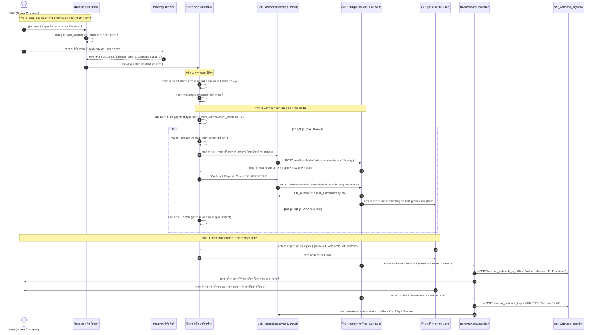

# बोल्ट सेंड पार्सल एपीआई (Bolt Send API) — लिकर जंक्शन हेतु सम्पूर्ण लारवेल इम्प्लीमेंटेशन गाइड
## (अपडेटेड आर्किटेक्चर: कस्टमर लोकेशन पिनअप + एडमिन ऑनलाइन पेमेंट गेट व डिस्पैच)

---

## 1. आर्किटेक्चर का संक्षिप्त विवरण (Architecture Overview)

यह गाइड **LiquorJunction** (घाना: अक्रा, कुमासी) के लिए **Bolt Send API (`vehicle_category: "delivery"`)** के सटीक और नए बिजनेस फ्लो के अनुसार तैयार की गई है।

### नए व्यावसायिक नियम (Business Rules):
1. **ऑर्डर / चेकआउट के समय (ग्राहक साइड - नो बोल्ट कॉल)**:
   * ग्राहक चेकआउट या एड्रेस सेव करते समय गूगल मैप पर अपने गेट का पिन (Pinup) चुनता है।
   * सिस्टम केवल अक्षांश व देशांतर (`latitude`, `longitude`) को `user_address` टेबल में सेव करता है और ऑर्डर के समय इसका स्थायी स्नैपशॉट `order.delivery_latitude` और `order.delivery_longitude` में दर्ज कर लेता है।
   * **चेकआउट के समय बोल्ट एपीआई पर कोई भी कॉल नहीं होगी!** कोई फेयर एस्टीमेशन या फेयर-लॉक नहीं होगा।
   * डिलीवरी चार्ज व पेमेंट प्रक्रिया प्लेटफॉर्म के मौजूदा सिस्टम (जैसे MojoPay ऑनलाइन गेटवे या सामान्य फ्लो) के अनुसार ही पूरी होगी।
2. **एडमिन साइड में बोल्ट एपीआई का संपूर्ण कार्य**:
   * बोल्ट एपीआई के सभी कॉल्स और बुकिंग केवल **एडमिन डैशबोर्ड** (`Dashboard/OrderController`) से नियंत्रित होंगे।
   * **पिकअप लोकेशन**: जिस दुकान/सप्लायर से शराब पिक होनी है, उसका लेट-लॉन्ग (`store_details.latitude`, `store_details.longitude`, `address` वाया `$order->supplier_id`) अपने-आप उपयोग होगा। मौजूदा वेयरहाउस/स्टोर फ्लो में कोई बदलाव नहीं होगा।
   * **ड्रॉप-ऑफ लोकेशन**: ग्राहक द्वारा चेकआउट के समय मैप पर पिन किया गया लेट-लॉन्ग (`order.delivery_latitude`, `order.delivery_longitude`) सीधे उपयोग होगा।
3. **एडमिन ट्रिगर एवं ऑनलाइन पेमेंट कंडीशन (Condition Gate)**:
   * **शर्त**: एडमिन ऑर्डर व्यू में **"Send Package via Bolt Send" (बोल्ट सेंड द्वारा पार्सल भेजें)** का विकल्प **केवल तभी दिखाई देगा जब ऑर्डर "Online Payment" द्वारा पेड हो** (`payment_type == 1` और `payment_status == 1`) और होम डिलीवरी (`order_type == 1`) हो।
   * यदि ऑर्डर **कैश ऑन डिलीवरी (COD / `payment_type == 3`)**, स्टोर पिकअप (`order_type == 2`), या अनपेड है, तो बोल्ट का बटन **पूरी तरह छुपा (Hidden)** रहेगा।
   * बटन पर क्लिक करने पर एक कॉन्फ़िगरेशन मोडल खुलेगा जिसमें पिकअप (स्टोर) और ड्रॉप-ऑफ (कस्टमर पिन) की पुष्टि होगी, लाइव बोल्ट कोटेशन लोड होगा और कन्फर्म करने पर कूरियर डिस्पैच हो जाएगा।
4. **स्थायी वेबहुक ऑडिट लॉगिंग (`bolt_webhook_logs`)**:
   * बोल्ट से आने वाले प्रत्येक वेबहुक का रॉ पेलोड, हेडर्स, आईपी और टाइमस्टैम्प डाटाबेस में हमेशा के लिए सुरक्षित रहेगा ("कब, क्या, कैसे कॉल हुआ")।

---

### सम्पूर्ण डिलीवरी फ़्लो आरेख (Sequence Diagram)



---

## 2. पहले क्या चाहिए (Prerequisites & Requirements)

सिस्टम शुरू करने से पहले निम्नलिखित कीज़ और तालिकाओं का होना आवश्यक है:

### 2.1 पर्यावरण चर (.env) कॉन्फ़िगरेशन
`.env` फ़ाइल में जोड़ें:
```env
# ========================================================
# बोल्ट एपीआई क्रेडेंशियल्स (BOLT SEND API)
# ========================================================
BOLT_ENV=sandbox # 'sandbox' या 'production'
BOLT_CLIENT_ID=your_bolt_client_id_here
BOLT_CLIENT_SECRET=your_bolt_client_secret_here
BOLT_SANDBOX_UUID=b1034a93-c5af-4fa1-a3b5-1bdb255f8967
BOLT_WEBHOOK_SECRET=your_custom_secure_bearer_token_for_webhooks
BOLT_DEFAULT_COUNTRY=GH
BOLT_CURRENCY=GHS

# ========================================================
# गूगल मैप्स एपीआई की (लोकेशन पिनअप हेतु)
# ========================================================
GOOGLE_MAPS_API_KEY=your_google_maps_browser_key_here
```

### 2.2 बोल्ट कॉन्फ़िगरेशन फ़ाइल: `config/bolt.php`
```php
<?php

return [
    'env' => env('BOLT_ENV', 'sandbox'),
    'client_id' => env('BOLT_CLIENT_ID'),
    'client_secret' => env('BOLT_CLIENT_SECRET'),
    'sandbox_uuid' => env('BOLT_SANDBOX_UUID'),
    'webhook_secret' => env('BOLT_WEBHOOK_SECRET'),

    'oauth_url' => 'https://oidc.bolt.eu/token',
    
    'base_url' => env('BOLT_ENV') === 'production'
        ? 'https://node.bolt.eu/ride-booker-api/reseller/v1/'
        : 'https://node.bolt.eu/ride-booker-api-sandbox/reseller/v1/sandbox/',

    'estimations_url' => env('BOLT_ENV') === 'production'
        ? 'https://node.bolt.eu/ride-booker-api/reseller/v2/rides/estimations'
        : 'https://node.bolt.eu/ride-booker-api-sandbox/reseller/v2/sandbox/rides/estimations',

    'country' => env('BOLT_DEFAULT_COUNTRY', 'GH'),
    'currency' => env('BOLT_CURRENCY', 'GHS'),
    'google_maps_key' => env('GOOGLE_MAPS_API_KEY'),
];
```

---

## 3. डेटाबेस माइग्रेशन्स (Database Migrations)

### 3.1 माइग्रेशन 1: `user_address` और `order` टेबल में कोऑर्डिनेट्स जोड़ें
```bash
php artisan make:migration add_coordinates_to_user_address_and_order_tables
```

```php
<?php

use Illuminate\Database\Migrations\Migration;
use Illuminate\Database\Schema\Blueprint;
use Illuminate\Support\Facades\Schema;

return new class extends Migration
{
    public function up()
    {
        // 1. ग्राहक की शिपिंग एड्रेस बुक (user_address)
        Schema::table('user_address', function (Blueprint $table) {
            $table->decimal('latitude', 10, 7)->nullable()->after('address');
            $table->decimal('longitude', 10, 7)->nullable()->after('latitude');
            $table->string('place_id')->nullable()->after('longitude');
            $table->text('formatted_address')->nullable()->after('place_id');
        });

        // 2. ऑर्डर शिपिंग स्नैपशॉट (ताकि बाद में प्रोफाइल एड्रेस बदलने पर भी ऑर्डर की लोकेशन न बदले)
        Schema::table('order', function (Blueprint $table) {
            $table->decimal('delivery_latitude', 10, 7)->nullable()->after('delivery_address');
            $table->decimal('delivery_longitude', 10, 7)->nullable()->after('delivery_latitude');
        });
    }

    public function down()
    {
        Schema::table('user_address', function (Blueprint $table) {
            $table->dropColumn(['latitude', 'longitude', 'place_id', 'formatted_address']);
        });

        Schema::table('order', function (Blueprint $table) {
            $table->dropColumn(['delivery_latitude', 'delivery_longitude']);
        });
    }
};
```

### 3.2 माइग्रेशन 2: `bolt_deliveries` टेबल बनाएं
```bash
php artisan make:migration create_bolt_deliveries_table
```

```php
<?php

use Illuminate\Database\Migrations\Migration;
use Illuminate\Database\Schema\Blueprint;
use Illuminate\Support\Facades\Schema;

return new class extends Migration
{
    public function up()
    {
        Schema::create('bolt_deliveries', function (Blueprint $table) {
            $table->id();
            $table->unsignedBigInteger('order_id')->index();
            $table->string('ride_id')->nullable()->index();
            $table->string('fare_id')->nullable();
            $table->timestamp('fare_locked_at')->nullable();
            $table->string('vehicle_category')->default('delivery'); // 'delivery' = Bolt Send
            $table->string('state')->default('CREATED');
            $table->decimal('pickup_lat', 10, 7);
            $table->decimal('pickup_lng', 10, 7);
            $table->string('pickup_address')->nullable();
            $table->decimal('dropoff_lat', 10, 7);
            $table->decimal('dropoff_lng', 10, 7);
            $table->string('dropoff_address')->nullable();
            $table->string('recipient_name');
            $table->string('recipient_phone');
            $table->text('note_to_driver')->nullable();
            $table->string('driver_name')->nullable();
            $table->string('driver_phone')->nullable();
            $table->string('car_model')->nullable();
            $table->string('car_reg_number')->nullable();
            $table->string('driver_picture')->nullable();
            $table->string('tracking_url')->nullable();
            $table->decimal('estimated_amount', 10, 2)->nullable();
            $table->decimal('final_amount', 10, 2)->nullable();
            $table->string('currency', 10)->default('GHS');
            $table->string('invoice_url')->nullable();
            $table->json('raw_response')->nullable();
            $table->timestamps();

            $table->foreign('order_id')->references('id')->on('order')->onDelete('cascade');
        });
    }

    public function down()
    {
        Schema::dropIfExists('bolt_deliveries');
    }
};
```

### 3.3 माइग्रेशन 3: `bolt_webhook_logs` टेबल (ऑडिट लॉगिंग)
```bash
php artisan make:migration create_bolt_webhook_logs_table
```

```php
<?php

use Illuminate\Database\Migrations\Migration;
use Illuminate\Database\Schema\Blueprint;
use Illuminate\Support\Facades\Schema;

return new class extends Migration
{
    public function up()
    {
        Schema::create('bolt_webhook_logs', function (Blueprint $table) {
            $table->id();
            $table->string('event_type')->index();
            $table->string('ride_id')->nullable()->index();
            $table->string('state')->nullable()->index();
            $table->string('ip_address')->nullable();
            $table->json('headers')->nullable();
            $table->json('payload'); // पूरा कच्चा पेलोड सुरक्षित रहेगा
            $table->integer('http_status')->default(200);
            $table->text('error_message')->nullable();
            $table->timestamps();
        });
    }

    public function down()
    {
        Schema::dropIfExists('bolt_webhook_logs');
    }
};
```

---

## 4. ग्राहक साइड लोकेशन पिनअप (बिना किसी बोल्ट एपीआई कॉल के)

चेकआउट या एड्रेस फॉर्म पर ग्राहक मैप पर पिन सेट करेगा। केवल `latitude` और `longitude` स्टोर होंगे।

### 4.1 एड्रेस फॉर्म ब्लेड कम्पोनेंट (`resources/views/frontend/address/address_modal.blade.php`)
```html
<div class="form-group mb-3">
    <label class="form-label font-weight-bold">
        <i class="fa fa-map-marker-alt text-danger"></i> नक्शे पर डिलीवरी स्थान पिन करें (Pinup)
    </label>
    <p class="text-muted small mb-2">सटीक डिलीवरी के लिए मार्कर को अपने घर/गेट के पास ड्रैग करें।</p>
    
    <input id="map-search-box" type="text" class="form-control mb-2" placeholder="सड़क या डिजिटल एड्रेस खोजें...">
    
    <div id="customer-picker-map" style="height: 280px; width: 100%; border-radius: 8px; border: 1px solid #ddd;"></div>
</div>

<!-- हिडन इनपुट्स -->
<input type="hidden" name="latitude" id="address-latitude" value="{{ old('latitude', @$userAddress->latitude) }}">
<input type="hidden" name="longitude" id="address-longitude" value="{{ old('longitude', @$userAddress->longitude) }}">
<input type="hidden" name="place_id" id="address-place-id" value="{{ old('place_id', @$userAddress->place_id) }}">
<input type="hidden" name="formatted_address" id="address-formatted" value="{{ old('formatted_address', @$userAddress->formatted_address) }}">
```

### 4.2 गूगल मैप्स जावास्क्रिप्ट लॉजिक
```javascript
let map, marker, autocomplete;
const DEFAULT_LAT = 5.6037; // अक्रा केंद्र
const DEFAULT_LNG = -0.1870;

function initCustomerAddressMap() {
    const existingLat = parseFloat(document.getElementById('address-latitude').value) || DEFAULT_LAT;
    const existingLng = parseFloat(document.getElementById('address-longitude').value) || DEFAULT_LNG;
    const initialPosition = { lat: existingLat, lng: existingLng };

    map = new google.maps.Map(document.getElementById('customer-picker-map'), {
        center: initialPosition,
        zoom: 15,
        mapTypeControl: false,
        streetViewControl: false,
    });

    marker = new google.maps.Marker({
        position: initialPosition,
        map: map,
        draggable: true,
        animation: google.maps.Animation.DROP,
        title: "मार्कर को अपने गेट पर ड्रैग करें"
    });

    const searchInput = document.getElementById('map-search-box');
    autocomplete = new google.maps.places.Autocomplete(searchInput, {
        componentRestrictions: { country: "gh" }, // केवल घाना में सीमित
        fields: ["geometry", "formatted_address", "place_id"]
    });

    autocomplete.addListener('place_changed', function() {
        const place = autocomplete.getPlace();
        if (!place.geometry || !place.geometry.location) return;

        map.setCenter(place.geometry.location);
        map.setZoom(17);
        marker.setPosition(place.geometry.location);
        updateHiddenCoordinates(place.geometry.location.lat(), place.geometry.location.lng(), place.place_id, place.formatted_address);
    });

    google.maps.event.addListener(marker, 'dragend', function(event) {
        updateHiddenCoordinates(event.latLng.lat(), event.latLng.lng());
    });
}

function updateHiddenCoordinates(lat, lng, placeId = '', formatted = '') {
    document.getElementById('address-latitude').value = lat;
    document.getElementById('address-longitude').value = lng;
    if (placeId) document.getElementById('address-place-id').value = placeId;
    if (formatted) document.getElementById('address-formatted').value = formatted;
}
```

### 4.3 ऑर्डर प्लेसमेंट स्नैपशॉट (`CheckoutController.php`)
चेकआउट के समय `storePlaceOrder()` में केवल पिन किए गए लेट-लॉन्ग को ऑर्डर पर कॉपी किया जाता है (बोल्ट एपीआई को कॉल किए बिना):
```php
// CheckoutController@storePlaceOrder:
$order->delivery_address = $delivery_address;
$order->delivery_address_id = $user_address_id;

// पिन किए गए कोऑर्डिनेट्स का स्नैपशॉट
if ($user_address_data) {
    $order->delivery_latitude = $user_address_data->latitude;
    $order->delivery_longitude = $user_address_data->longitude;
}

$order->save();

// ग्राहक सामान्य रूप से MojoPay पेमेंट गेटवे पर भुगतान पूरा करता है
```

---

## 5. बोल्ट सेंड सर्विस क्लास (BoltRideBookerService)

फ़ाइल: `app/Services/BoltRideBookerService.php`

```php
<?php

namespace App\Services;

use Illuminate\Support\Facades\Http;
use Illuminate\Support\Facades\Cache;
use Illuminate\Support\Facades\Log;
use Carbon\Carbon;
use Exception;

class BoltRideBookerService
{
    protected string $baseUrl;
    protected string $estimationsUrl;
    protected string $clientId;
    protected string $clientSecret;
    protected ?string $sandboxUuid;

    public function __construct()
    {
        $this->baseUrl = config('bolt.base_url');
        $this->estimationsUrl = config('bolt.estimations_url');
        $this->clientId = config('bolt.client_id');
        $this->clientSecret = config('bolt.client_secret');
        $this->sandboxUuid = config('bolt.sandbox_uuid');
    }

    /**
     * OAuth2 एक्सेस टोकन प्राप्त करें (50 मिनट के लिए कैश)
     */
    public function getAccessToken(): string
    {
        return Cache::remember('bolt_access_token', 3000, function () {
            $response = Http::asForm()->post(config('bolt.oauth_url'), [
                'grant_type' => 'client_credentials',
                'client_id' => $this->clientId,
                'client_secret' => $this->clientSecret,
                'scope' => 'ridebooker:reseller',
            ]);

            if ($response->failed()) {
                Log::error('Bolt OAuth2 Error: ' . $response->body());
                throw new Exception('बोल्ट ऑथेंटिकेशन असफल: ' . $response->status());
            }

            return $response->json()['access_token'];
        });
    }

    /**
     * बोल्ट सेंड लाइव एस्टीमेट प्राप्त करें (vehicle_category: 'delivery')
     */
    public function getBoltSendEstimate(array $pickup, array $dropoff): array
    {
        $token = $this->getAccessToken();

        $headers = [
            'Authorization' => 'Bearer ' . $token,
            'Content-Type' => 'application/json',
        ];

        if (config('bolt.env') !== 'production' && $this->sandboxUuid) {
            $headers['X-Sandbox-UUID'] = $this->sandboxUuid;
        }

        $payload = [
            'pickup' => [
                'lat' => (float)$pickup['lat'],
                'lng' => (float)$pickup['lng'],
                'address' => $pickup['address'] ?? 'LiquorJunction Store',
            ],
            'dropoff' => [
                'lat' => (float)$dropoff['lat'],
                'lng' => (float)$dropoff['lng'],
                'address' => $dropoff['address'] ?? 'Customer Destination',
            ],
        ];

        $response = Http::withHeaders($headers)->post($this->estimationsUrl, $payload);

        if ($response->failed()) {
            Log::error('Bolt Estimation Error: ' . $response->body());
            throw new Exception('बोल्ट एस्टीमेट प्राप्त करने में त्रुटि: ' . $response->body());
        }

        $data = $response->json();
        $categories = $data['categories'] ?? [];

        // पार्सल डिलीवरी कैटेगरी का मिलान करें ('delivery' या 'motorbike')
        $deliveryCategory = null;
        foreach ($categories as $cat) {
            $catName = strtolower($cat['vehicle_category'] ?? '');
            if ($catName === 'delivery' || $catName === 'motorbike') {
                $deliveryCategory = $cat;
                break;
            }
        }

        if (!$deliveryCategory) {
            $deliveryCategory = $categories[0] ?? null;
        }

        if (!$deliveryCategory) {
            throw new Exception('इस क्षेत्र में कोई भी बोल्ट सेंड राइडर उपलब्ध नहीं है।');
        }

        return [
            'fare_id' => $deliveryCategory['fare_id'],
            'price_amount' => $deliveryCategory['price']['amount'] ?? 0,
            'currency' => $deliveryCategory['price']['currency'] ?? 'GHS',
            'eta_seconds' => $deliveryCategory['eta'] ?? 300,
            'vehicle_category' => $deliveryCategory['vehicle_category'] ?? 'delivery',
            'quoted_at' => Carbon::now()->toIso8601String(),
        ];
    }

    /**
     * बोल्ट सेंड कूरियर राइड बुक व डिस्पैच करें
     */
    public function createBoltSendRide(
        string $fareId,
        array $pickup,
        array $dropoff,
        string $recipientName,
        string $recipientPhone,
        string $orderNumber,
        ?string $quotedAt = null
    ): array {
        // यदि fare_id 2 मिनट से पुराना हो चुका है, तो तुरंत नया fare_id प्राप्त करें
        if ($quotedAt && Carbon::parse($quotedAt)->diffInMinutes(Carbon::now()) >= 2) {
            Log::info("Fare ID पुराना हो चुका है। ऑर्डर #{$orderNumber} के लिए नया कोटेशन लिया जा रहा है...");
            $freshQuote = $this->getBoltSendEstimate($pickup, $dropoff);
            $fareId = $freshQuote['fare_id'];
        }

        $token = $this->getAccessToken();
        $url = rtrim($this->baseUrl, '/') . '/rides/create';

        $headers = [
            'Authorization' => 'Bearer ' . $token,
            'Content-Type' => 'application/json',
        ];

        if (config('bolt.env') !== 'production' && $this->sandboxUuid) {
            $headers['X-Sandbox-UUID'] = $this->sandboxUuid;
        }

        $formattedPhone = $this->sanitizeGhanaPhone($recipientPhone);

        $payload = [
            'fare_id' => $fareId,
            'pickup' => [
                'lat' => (float)$pickup['lat'],
                'lng' => (float)$pickup['lng'],
                'address' => $pickup['address'] ?? 'Store Pickup',
            ],
            'dropoff' => [
                'lat' => (float)$dropoff['lat'],
                'lng' => (float)$dropoff['lng'],
                'address' => $dropoff['address'] ?? 'Customer Dropoff',
            ],
            'passenger' => [
                'first_name' => $recipientName,
                'last_name' => '(पार्सल प्राप्तकर्ता)',
                'phone' => $formattedPhone,
            ],
            'payment_method' => 'business',
            'order_reference' => 'LJ-' . $orderNumber,
            'comment' => "FRAGILE LIQUOR PARCEL. Order #{$orderNumber}. Meet store staff at vehicle for curbside pickup.",
        ];

        $response = Http::withHeaders($headers)->post($url, $payload);

        if ($response->failed()) {
            Log::error('Bolt Ride Creation Error: ' . $response->body());
            throw new Exception('बोल्ट राइड बुकिंग असफल: ' . $response->body());
        }

        return $response->json();
    }

    /**
     * फोन नंबर को +233 फॉर्मेट में बदलना
     */
    protected function sanitizeGhanaPhone(string $phone): string
    {
        $cleaned = preg_replace('/[^0-9]/', '', $phone);
        if (str_starts_with($cleaned, '233')) return '+' . $cleaned;
        if (str_starts_with($cleaned, '0')) return '+233' . substr($cleaned, 1);
        return '+233' . $cleaned;
    }

    public function getRideDetails(int $rideId): array
    {
        $token = $this->getAccessToken();
        $url = rtrim($this->baseUrl, '/') . "/rides/{$rideId}/details";

        $headers = ['Authorization' => 'Bearer ' . $token];
        if (config('bolt.env') !== 'production' && $this->sandboxUuid) {
            $headers['X-Sandbox-UUID'] = $this->sandboxUuid;
        }

        $response = Http::withHeaders($headers)->get($url);
        return $response->json();
    }

    public function getRideReceipt(int $rideId): array
    {
        $token = $this->getAccessToken();
        $url = rtrim($this->baseUrl, '/') . "/rides/{$rideId}/receipt";

        $headers = ['Authorization' => 'Bearer ' . $token];
        if (config('bolt.env') !== 'production' && $this->sandboxUuid) {
            $headers['X-Sandbox-UUID'] = $this->sandboxUuid;
        }

        $response = Http::withHeaders($headers)->get($url);
        return $response->json();
    }
}
```

---

## 6. एडमिन पैनल: ऑनलाइन पेमेंट कंडीशन व डिस्पैच मोडल

### 6.1 एडमिन ऑर्डर व्यू में कंडीशन चेक (`resources/views/dashboard/order/show.blade.php`)

```blade
{{-- केवल ऑनलाइन पेमेंट (Paid) और होम डिलीवरी ऑर्डर्स के लिए बोल्ट सेंड विकल्प दिखाएं --}}
@php
    $isHomeDelivery = ($orderData->order_type == 1);
    $isOnlinePaid = ($orderData->payment_type == 1 && $orderData->payment_status == 1);
    $existingDelivery = \DB::table('bolt_deliveries')->where('order_id', $orderData->id)->latest()->first();
@endphp

@if($isHomeDelivery && $isOnlinePaid)
    <div class="card border-primary shadow-sm mb-4">
        <div class="card-header bg-primary text-white d-flex justify-content-between align-items-center">
            <h5 class="mb-0"><i class="fa fa-motorcycle"></i> बोल्ट सेंड कूरियर डिलीवरी (Bolt Send)</h5>
            <span class="badge badge-light text-primary font-weight-bold">ऑनलाइन पेमेंट सत्यापित</span>
        </div>
        <div class="card-body">
            @if(!$existingDelivery)
                <p class="text-muted">
                    यह ऑर्डर ऑनलाइन पेमेंट द्वारा चुकाया गया है। ग्राहक के पिन किए गए जीपीएस कोऑर्डिनेट्स तैयार हैं। 
                    कूरियर बुलाने से पहले शराब की बोतलें सीलबंद कार्टन में पैक होना सुनिश्चित करें।
                </p>
                <button type="button" class="btn btn-success" id="btn-open-bolt-modal" data-order-id="{{ $orderData->id }}">
                    <i class="fa fa-paper-plane"></i> Send Package via Bolt Send (पार्सल भेजें)
                </button>
            @else
                <div class="alert alert-info d-flex justify-content-between align-items-center mb-0">
                    <div>
                        <strong>बोल्ट राइड आईडी: #{{ $existingDelivery->ride_id }}</strong> | 
                        स्थिति: <span class="badge badge-warning text-uppercase">{{ $existingDelivery->state }}</span>
                        @if($existingDelivery->driver_name)
                            <div class="small mt-1">ड्राइवर: {{ $existingDelivery->driver_name }} ({{ $existingDelivery->car_reg_number }}) - फोन: {{ $existingDelivery->driver_phone }}</div>
                        @endif
                    </div>
                    @if($existingDelivery->tracking_url)
                        <a href="{{ $existingDelivery->tracking_url }}" target="_blank" class="btn btn-sm btn-outline-primary">
                            <i class="fa fa-map-marked-alt"></i> लाइव जीपीएस ट्रैकिंग
                        </a>
                    @endif
                </div>
            @endif
        </div>
    </div>
@elseif($orderData->payment_type == 3)
    <div class="alert alert-warning mb-4">
        <i class="fa fa-info-circle"></i> <strong>कैश ऑन डिलीवरी (COD) ऑर्डर:</strong> 
        बोल्ट सेंड कॉर्पोरेट अकाउंट से प्री-पेड होता है। COD ऑर्डर्स दुकान के अपने इन-हाउस डिलीवरी स्टाफ द्वारा भेजे जाने चाहिए।
    </div>
@elseif(!$isOnlinePaid)
    <div class="alert alert-secondary mb-4">
        <i class="fa fa-clock"></i> <strong>भुगतान लंबित:</strong> 
        ऑनलाइन पेमेंट सफल होने के बाद ही बोल्ट कूरियर डिस्पैच विकल्प सक्रिय होगा।
    </div>
@endif
```

### 6.2 एडमिन बोल्ट डिस्पैच मोडल (HTML / Blade)
```html
<div class="modal fade" id="boltDispatchModal" tabindex="-1" role="dialog" aria-hidden="true">
    <div class="modal-dialog modal-lg" role="document">
        <div class="modal-content">
            <div class="modal-header bg-dark text-white">
                <h5 class="modal-title"><i class="fa fa-shipping-fast text-warning"></i> बोल्ट सेंड कूरियर डिस्पैच कॉन्फ़िगरेशन</h5>
                <button type="button" class="close text-white" data-dismiss="modal">&times;</button>
            </div>
            <div class="modal-body">
                <div id="bolt-loading" class="text-center py-4">
                    <div class="spinner-border text-primary" role="status"></div>
                    <p class="mt-2 text-muted">रूट व लाइव बोल्ट कोटेशन लोड हो रहा है...</p>
                </div>

                <div id="bolt-content" style="display: none;">
                    <div class="row">
                        <!-- पिकअप कॉलम (स्टोर) -->
                        <div class="col-md-6 border-right">
                            <h6 class="text-success font-weight-bold"><i class="fa fa-store"></i> स्टोर पिकअप लोकेशन (Store)</h6>
                            <p class="mb-1" id="pickup-store-name"><strong>LiquorJunction Store</strong></p>
                            <p class="small text-muted mb-1" id="pickup-store-address"></p>
                            <span class="badge badge-light" id="pickup-store-coords"></span>
                        </div>

                        <!-- ड्रॉप-ऑफ कॉलम (कस्टमर) -->
                        <div class="col-md-6">
                            <h6 class="text-primary font-weight-bold"><i class="fa fa-map-pin"></i> ग्राहक ड्रॉप-ऑफ लोकेशन (Pinned)</h6>
                            <p class="mb-1" id="dropoff-recipient-name"></p>
                            <p class="small text-muted mb-1" id="dropoff-customer-address"></p>
                            <span class="badge badge-light" id="dropoff-customer-coords"></span>
                        </div>
                    </div>

                    <hr>

                    <div class="bg-light p-3 rounded mb-3">
                        <div class="d-flex justify-content-between">
                            <span><i class="fa fa-box text-warning"></i> <strong>पैकेज:</strong> सीलबंद शराब कार्टन (मैक्स 15 kg)</span>
                            <span><i class="fa fa-shield-alt text-success"></i> कर्बसाइड सत्यापन: <strong>18+ आयु अनिवार्य</strong></span>
                        </div>
                    </div>

                    <!-- लाइव किराया बॉक्स -->
                    <div class="card border-success">
                        <div class="card-body d-flex justify-content-between align-items-center">
                            <div>
                                <h6 class="mb-0 text-muted">अनुमानित बोल्ट कूरियर चार्ज:</h6>
                                <h3 class="mb-0 text-success font-weight-bold" id="quote-fee-amount">0.00 GHS</h3>
                            </div>
                            <div class="text-right">
                                <span class="badge badge-info p-2" id="quote-eta">ETA: ~5 मिनट</span>
                            </div>
                        </div>
                    </div>

                    <input type="hidden" id="modal-fare-id">
                    <input type="hidden" id="modal-quoted-at">
                </div>
            </div>
            <div class="modal-footer">
                <button type="button" class="btn btn-secondary" data-dismiss="modal">रद्द करें</button>
                <button type="button" class="btn btn-primary" id="btn-confirm-bolt-dispatch" disabled>
                    <i class="fa fa-check-circle"></i> Confirm & Dispatch Courier
                </button>
            </div>
        </div>
    </div>
</div>
```

### 6.3 एडमिन AJAX जावास्क्रिप्ट
```javascript
$(document).ready(function() {
    $('#btn-open-bolt-modal').on('click', function() {
        const orderId = $(this).data('order-id');
        $('#boltDispatchModal').modal('show');
        $('#bolt-loading').show();
        $('#bolt-content').hide();
        $('#btn-confirm-bolt-dispatch').prop('disabled', true);

        // बैकएंड से पिकअप व ड्रॉपऑफ प्रीव्यू और लाइव कोटेशन प्राप्त करें
        $.ajax({
            url: `/admin/order/${orderId}/bolt-preview`,
            type: 'GET',
            success: function(res) {
                if (res.success) {
                    $('#pickup-store-name').text(res.pickup.store_name);
                    $('#pickup-store-address').text(res.pickup.address);
                    $('#pickup-store-coords').text(`Lat: ${res.pickup.lat}, Lng: ${res.pickup.lng}`);

                    $('#dropoff-recipient-name').text(`${res.dropoff.recipient_name} (${res.dropoff.recipient_phone})`);
                    $('#dropoff-customer-address').text(res.dropoff.address);
                    $('#dropoff-customer-coords').text(`Lat: ${res.dropoff.lat}, Lng: ${res.dropoff.lng}`);

                    $('#quote-fee-amount').text(`${res.estimate.fee} ${res.estimate.currency}`);
                    $('#quote-eta').text(`ड्राइवर पहुंचने का समय: ~${res.estimate.eta_mins} मिनट`);

                    $('#modal-fare-id').val(res.estimate.fare_id);
                    $('#modal-quoted-at').val(res.estimate.quoted_at);

                    $('#bolt-loading').hide();
                    $('#bolt-content').show();
                    $('#btn-confirm-bolt-dispatch').prop('disabled', false).data('order-id', orderId);
                } else {
                    alert('त्रुटि: ' + res.message);
                    $('#boltDispatchModal').modal('hide');
                }
            },
            error: function(err) {
                alert('बोल्ट एपीआई से कनेक्ट नहीं हो सका: ' + (err.responseJSON ? err.responseJSON.message : 'Unknown error'));
                $('#boltDispatchModal').modal('hide');
            }
        });
    });

    $('#btn-confirm-bolt-dispatch').on('click', function() {
        const orderId = $(this).data('order-id');
        const fareId = $('#modal-fare-id').val();
        const quotedAt = $('#modal-quoted-at').val();

        $(this).prop('disabled', true).html('<i class="fa fa-spinner fa-spin"></i> कूरियर बुक हो रहा है...');

        $.ajax({
            url: `/admin/order/${orderId}/dispatch-bolt`,
            type: 'POST',
            data: {
                _token: '{{ csrf_token() }}',
                fare_id: fareId,
                quoted_at: quotedAt
            },
            success: function(res) {
                if (res.success) {
                    alert('बोल्ट सेंड कूरियर सफलतापूर्वक बुक हो गया! राइड आईडी: ' + res.ride_id);
                    location.reload();
                } else {
                    alert('डिस्पैच असफल: ' + res.message);
                    $('#btn-confirm-bolt-dispatch').prop('disabled', false).html('<i class="fa fa-check-circle"></i> Confirm & Dispatch Courier');
                }
            },
            error: function(err) {
                alert('नेटवर्क त्रुटि: ' + (err.responseJSON ? err.responseJSON.message : 'Error'));
                $('#btn-confirm-bolt-dispatch').prop('disabled', false).html('<i class="fa fa-check-circle"></i> Confirm & Dispatch Courier');
            }
        });
    });
});
```

---

## 7. एडमिन कंट्रोलर मेथड्स (`Dashboard/OrderController.php`)

```php
<?php

namespace App\Http\Controllers\Dashboard;

use App\Http\Controllers\Controller;
use Illuminate\Http\Request;
use App\Models\Order;
use App\Models\UserAddress;
use App\Models\StoreDetails;
use App\Services\BoltRideBookerService;
use Illuminate\Support\Facades\DB;
use Carbon\Carbon;
use Exception;

class OrderController extends Controller
{
    /**
     * पिकअप व ड्रॉपऑफ प्रीव्यू और लाइव कोटेशन
     */
    public function getBoltSendPreview($orderId, BoltRideBookerService $boltService)
    {
        $order = Order::with('orderInfo')->findOrFail($orderId);

        // पात्रता शर्तें: होम डिलीवरी और ऑनलाइन भुगतान
        if ($order->order_type != 1) {
            return response()->json(['success' => false, 'message' => 'स्टोर पिकअप ऑर्डर्स बोल्ट द्वारा नहीं भेजे जा सकते।'], 400);
        }

        if ($order->payment_type != 1 || $order->payment_status != 1) {
            return response()->json(['success' => false, 'message' => 'बोल्ट सेंड केवल सत्यापित ऑनलाइन भुगतान वाले ऑर्डर्स के लिए मान्य है।'], 400);
        }

        // 1. स्टोर पिकअप लोकेशन (मौजूदा वेयरहाउस फ्लो के अनुसार)
        $store = null;
        if (!empty($order->supplier_id)) {
            $store = StoreDetails::where('id', $order->supplier_id)->orWhere('wholesaler_id', $order->supplier_id)->first();
        }
        if (!$store) {
            $store = StoreDetails::where('status', 1)->first();
        }

        $pickup = [
            'store_name' => $store->store_name ?? 'LiquorJunction Warehouse',
            'lat' => (float)$store->latitude,
            'lng' => (float)$store->longitude,
            'address' => $store->address ?? 'Accra, Ghana',
        ];

        // 2. कस्टमर ड्रॉप-ऑफ लोकेशन (चेकआउट के समय पिन किया गया GPS)
        $shippingAddress = UserAddress::find($order->delivery_address_id);
        $orderInfo = $order->orderInfo;

        $dropoffLat = $order->delivery_latitude ?? ($shippingAddress->latitude ?? null);
        $dropoffLng = $order->delivery_longitude ?? ($shippingAddress->longitude ?? null);

        if (!$dropoffLat || !$dropoffLng) {
            return response()->json([
                'success' => false,
                'message' => 'ग्राहक ने मैप पर लोकेशन पिन नहीं की है। कृपया पहले ग्राहक से सटीक लोकेशन प्राप्त करें।'
            ], 400);
        }

        $dropoff = [
            'recipient_name' => $order->recipientName ?: ($shippingAddress->name ?? ($orderInfo->customer_name ?? 'Customer')),
            'recipient_phone' => $shippingAddress->phone ?? ($orderInfo->customer_mobile ?? ''),
            'lat' => (float)$dropoffLat,
            'lng' => (float)$dropoffLng,
            'address' => $order->delivery_address ?: ($shippingAddress->address ?? 'Accra, Ghana'),
        ];

        // 3. बोल्ट लाइव कोटेशन कॉल
        try {
            $estimate = $boltService->getBoltSendEstimate(
                ['lat' => $pickup['lat'], 'lng' => $pickup['lng'], 'address' => $pickup['address']],
                ['lat' => $dropoff['lat'], 'lng' => $dropoff['lng'], 'address' => $dropoff['address']]
            );

            return response()->json([
                'success' => true,
                'pickup' => $pickup,
                'dropoff' => $dropoff,
                'estimate' => [
                    'fare_id' => $estimate['fare_id'],
                    'fee' => number_format($estimate['price_amount'], 2),
                    'currency' => $estimate['currency'],
                    'eta_mins' => round($estimate['eta_seconds'] / 60),
                    'quoted_at' => $estimate['quoted_at'],
                ]
            ]);
        } catch (Exception $e) {
            return response()->json(['success' => false, 'message' => $e->getMessage()], 400);
        }
    }

    /**
     * बोल्ट सेंड कूरियर डिस्पैच करें
     */
    public function dispatchBoltSend(Request $request, $orderId, BoltRideBookerService $boltService)
    {
        $request->validate([
            'fare_id' => 'required|string',
            'quoted_at' => 'nullable|string',
        ]);

        $order = Order::with('orderInfo')->findOrFail($orderId);

        if ($order->order_type != 1 || $order->payment_type != 1 || $order->payment_status != 1) {
            return response()->json(['success' => false, 'message' => 'यह ऑर्डर बोल्ट सेंड के लिए पात्र नहीं है।'], 400);
        }

        $store = StoreDetails::where('id', $order->supplier_id)->orWhere('wholesaler_id', $order->supplier_id)->first() ?? StoreDetails::first();
        $pickup = [
            'lat' => (float)$store->latitude,
            'lng' => (float)$store->longitude,
            'address' => $store->address ?? 'Accra Store',
        ];

        $shippingAddress = UserAddress::find($order->delivery_address_id);
        $orderInfo = $order->orderInfo;

        $dropoffLat = $order->delivery_latitude ?? ($shippingAddress->latitude ?? null);
        $dropoffLng = $order->delivery_longitude ?? ($shippingAddress->longitude ?? null);

        $recipientName = $order->recipientName ?: ($shippingAddress->name ?? ($orderInfo->customer_name ?? 'Customer'));
        $recipientPhone = $shippingAddress->phone ?? ($orderInfo->customer_mobile ?? '');

        $dropoff = [
            'lat' => (float)$dropoffLat,
            'lng' => (float)$dropoffLng,
            'address' => $order->delivery_address ?: ($shippingAddress->address ?? 'Accra'),
        ];

        try {
            $ride = $boltService->createBoltSendRide(
                $request->fare_id,
                $pickup,
                $dropoff,
                $recipientName,
                $recipientPhone,
                $order->order_id ?: $order->id,
                $request->quoted_at
            );

            $rideId = $ride['ride_id'];

            DB::table('bolt_deliveries')->insert([
                'order_id' => $order->id,
                'ride_id' => (string)$rideId,
                'fare_id' => $request->fare_id,
                'vehicle_category' => 'delivery',
                'state' => 'SEARCHING',
                'pickup_lat' => $pickup['lat'],
                'pickup_lng' => $pickup['lng'],
                'pickup_address' => $pickup['address'],
                'dropoff_lat' => $dropoff['lat'],
                'dropoff_lng' => $dropoff['lng'],
                'dropoff_address' => $dropoff['address'],
                'recipient_name' => $recipientName,
                'recipient_phone' => $recipientPhone,
                'currency' => 'GHS',
                'created_at' => Carbon::now(),
                'updated_at' => Carbon::now(),
            ]);

            // ऑर्डर स्टेटस 6 = Out for Delivery अपडेट करें
            $order->order_status = 6;
            $order->save();

            return response()->json([
                'success' => true,
                'ride_id' => $rideId,
                'message' => 'बोल्ट सेंड कूरियर सफलतापूर्वक डिस्पैच हो गया!'
            ]);
        } catch (Exception $e) {
            return response()->json(['success' => false, 'message' => $e->getMessage()], 400);
        }
    }
}
```

---

## 8. तीनों शर्तों का मिलान सारांश (Summary Table)

| ग्राहक की आवश्यकता | कोडबेस में समाधान |
| :--- | :--- |
| **1. चेकआउट पर केवल लोकेशन पिनअप (नो बोल्ट एपीआई कॉल)** | चेकआउट पेज पर गूगल मैप्स पिनअप से केवल `lat`/`lng` कैप्चर होकर `user_address` व `order.delivery_latitude`/`delivery_longitude` में सेव होता है। पेमेंट सामान्य फ्लो (MojoPay) से होता है। |
| **2. एडमिन में बोल्ट एपीआई व स्टोर पिकअप लेट-लॉन्ग** | एडमिन में पिकअप लोकेशन सीधे `$order->supplier_id` से जुड़े `store_details` के लेट-लॉन्ग से ली जाती है (मौजूदा स्टोर फ्लो में बिना कोई छेड़छाड़ किए)। ड्रॉप-ऑफ कस्टमर के पिन किए गए लेट-लॉन्ग से आता है। |
| **3. केवल ऑनलाइन पेमेंट ऑर्डर्स पर ही बोल्ट विकल्प** | ब्लेड व्यू (`@if($orderData->payment_type == 1 && $orderData->payment_status == 1)`) और कंट्रोलर दोनों में अनिवार्य शर्त लागू। क्लिक करने पर ही पिकअप-ड्रॉपऑफ मोडल खुलता है और कूरियर बुक होता है। |
